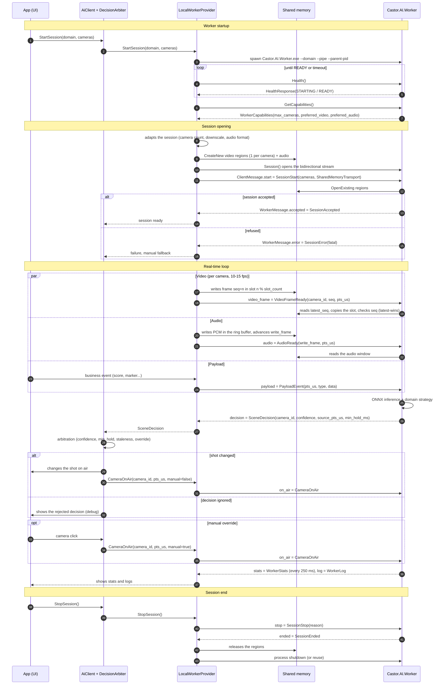

# Castor AI — Prototype architecture

Goal: validate the **AI <-> App** communication for real-time camera shot switching (stream).

- **App**: small Avalonia app that plays the role of Castor-Studio and shows what the real app would receive.
- **Worker**: single AI process per domain (podcast, football, basketball…). It receives payloads and/or video and/or audio, and sends back shot decisions (`SceneDecision`).

Scope: the architecture covers **local and cloud**. Only **local** is implemented in the prototype.

Contract: [`Castor.AI.Contracts/Protos/castor_ai.proto`](https://github.com/Castor-Studio/Castor-AI-Worker/blob/main/Castor.AI.Contracts/Protos/castor_ai.proto).
Client SDK used by the apps: [`Castor.AI`](https://github.com/Castor-Studio/Castor-AI-Worker/blob/main/Castor.AI/README.md) (`AiClient`).

---

## 1. Overview

```
Castor-Studio (Avalonia)
  AiClient (Castor.AI SDK) ── IAiProvider ──┐
  DecisionArbiter                     ├─ LocalWorkerProvider   [implemented]
                                      │    spawns + supervises Castor.AI.Worker.exe
                                      │    gRPC over named pipe: control, payloads, decisions
                                      │    media: shared memory (1 region per camera + 1 audio)
                                      │
                                      └─ CloudProvider   [design only]
                                           AiGateway.AllocateSession -> endpoint + ingest_uri
                                           gRPC TLS: control, payloads, decisions
                                           media: encoded stream (SRT, low-resolution H.264, Opus)
                                           ──> Worker pod: decoder ──SHM──> Worker (same binary)
```

### Components

| Component | Role |
|---|---|
| `AiClient` | Single facade on the app side (`Castor.AI` SDK). Session, clock, arbiter, audio feed. The app only knows this type. |
| `IAiProvider` | Local/cloud abstraction: start a session, push media, receive decisions. |
| `LocalWorkerProvider` | Starts the worker, creates the SHM regions, writes the frames, opens the gRPC stream, handles crashes and restarts. |
| `CloudProvider` | (design) Allocates a session through `AiGateway`, pushes an encoded stream, same gRPC stream. |
| `DecisionArbiter` | App side. Turns worker **suggestions** into the **shot on air**: confidence threshold, `min_hold_ms`, stale decision rejection, manual override. |
| `Castor.AI.Worker` | .NET + ONNX Runtime process. One binary, one domain chosen at launch. Identical locally and in the cloud. |
| `IFrameSource` (worker) | Media reading abstraction: SHM locally; in the cloud, SHM fed by the pod decoder. |

### Technical choices

- **Worker in C# .NET + ONNX Runtime.** Models are trained in Python then exported to `.onnx`. No Python runtime is shipped to the user. GPU through DirectML (Windows, all vendors); CUDA in the cloud.
- **Out-of-process worker.** Isolates crashes and GPU memory, and keeps the same shape locally and in the cloud.
- **gRPC for control, never for raw media.** Frames go through SHM; gRPC only carries notifications ("doorbell").
- **Local: gRPC over named pipe** (Kestrel `ListenNamedPipe`, .NET 8+). Possible fallback: `localhost` TCP.

---

## 2. Session lifecycle (local)

1. `LocalWorkerProvider` starts `Castor.AI.Worker.exe --domain <d> --pipe <name> --parent-pid <pid>`.
   - The worker exits if the parent process goes away.
2. `LocalWorkerProvider` calls `Health` until `STATUS_READY` (configurable timeout), then `GetCapabilities`.
3. The app adapts the session to the capabilities:
   - number of cameras ≤ `max_cameras`;
   - downscale to `preferred_video` (e.g. 640x360 BGRA, 10–15 fps);
   - audio to `preferred_audio` (e.g. 16 kHz, f32, 1 channel per microphone).
4. The app creates the SHM regions, then opens `Session` and sends `SessionStart`.
5. The worker maps the regions and answers `SessionAccepted` (or `SessionError`).
6. Loop:
   - app: writes frames and audio to SHM, sends `VideoFrameReady` / `AudioReady` and the `PayloadEvent`s;
   - worker: sends `SceneDecision`s, `WorkerStats` (every 250 ms) and `WorkerLog`s;
   - app: the arbiter picks the shot on air and sends `CameraOnAir` back to the worker.
7. End: `SessionStop`, then `SessionEnded`. The app releases the regions.

### Sequence diagram



### Failures

- gRPC stream broken or `Health` failing: the app goes into **fallback** (keeps the current shot or switches to manual mode), then restarts the worker with backoff (1 s, 2 s, 5 s…).
- No decision received for N seconds: `DecisionArbiter` reports "AI silent" in the UI, without changing the shot.
- `SessionError.fatal = true`: session over, handled like a disconnection.

---

## 3. Real time

- **Master clock = app.** `pts_us` in microseconds since `SessionStart`, monotonic. Every decision references `source_pts_us`.
- **Latest-wins.** The worker always processes the most recent frame and ignores the others (`frames_dropped`). No queue: delay never builds up.
- **Staleness.** The arbiter ignores a decision if `now - source_pts_us > max_decision_age_ms` (default 500 ms).
- **Target latency budget (local)**: < 300 ms between the source frame and the received decision. Measured and shown in the prototype app.
- **Hysteresis.** Applied by the arbiter, not the worker: `min_hold_ms`, confidence threshold, and a minimal score gap before changing the shot.

---

## 4. Shared memory layout

Naming:

- Windows: `Local\castor-<session_id>-video-<index>`, `Local\castor-<session_id>-audio`
- Linux (cloud): `/dev/shm/castor-<session_id>-...`

`<index>` = rank of the camera in `SessionStart.cameras`: a camera id may contain any character.
`VideoRegion.camera_id` carries the mapping. The SDK only creates the video regions if the worker declares
`INPUT_KIND_VIDEO` and a BGRA8 `preferred_video`; it then writes every camera at that size.

On the .NET side: `MemoryMappedFile.CreateNew` (app) / `OpenExisting` (worker). Little-endian. Every offset is 64-byte aligned.

### Video region (one per camera)

```
RegionHeader (64 B)
  0   u32  magic        = 'CSVF' (0x46565343)
  4   u16  version      = 1
  6   u16  slot_count   (>= 3)
  8   u32  slot_size    (bytes, slot header included, multiple of 64)
  12  u32  width
  16  u32  height
  20  u32  stride
  24  u32  pixel_format (enum PixelFormat)
  28  u32  reserved
  32  u64  latest_seq   (0 = no frame; written last, Volatile.Write)
  40..63   reserved

Slot[i] at offset 64 + i * slot_size
  SlotHeader (64 B)
    0   u64  seq          (written last)
    8   i64  pts_us
    16  u32  data_size
    20..63   reserved
  Data (data_size bytes)
```

**Write (app), frame `seq = n`:**

1. Pick `slot = n % slot_count`.
2. Set `slot.seq = 0` (slot invalid while writing).
3. Write `pts_us`, `data_size`, then the pixels.
4. `Volatile.Write(slot.seq, n)`.
5. `Volatile.Write(header.latest_seq, n)`.
6. Send `VideoFrameReady{seq = n}`.

**Read (worker):**

1. `n = Volatile.Read(latest_seq)`. If `n` = last processed: nothing to do.
2. `slot = n % slot_count`. Check `slot.seq == n`, copy the data, then read `slot.seq` again.
3. If `slot.seq` changed: torn frame, drop it (`frames_torn`) and start again at step 1.

With `slot_count >= 3` and a worker that copies the frame before inference, torn frames stay rare.

### Audio region

```
AudioHeader (64 B)
  0   u32  magic          = 'CSAU' (0x55415343)
  4   u16  version        = 1
  6   u16  channels
  8   u32  sample_rate
  12  u32  capacity_frames
  16  u64  write_frame    (total frames written; Volatile.Write after the data)
  24  i64  base_pts_us    (pts of frame 0)
  32..63   reserved
Data: interleaved float32 ring buffer, capacity_frames * channels
```

- `pts(frame k) = base_pts_us + k * 1e6 / sample_rate`.
- The worker reads the window `[write_frame - window, write_frame)`. If it falls behind by more than `capacity_frames`, it jumps forward.
- Microphone / camera mapping: `CameraDescriptor.audio_channel`.
- Recommended capacity: 2 s.

---

## 5. Cloud (design, not implemented)

1. `CloudProvider` calls `AiGateway.AllocateSession(domain, camera_count, inputs)` and receives `worker_endpoint`, `ingest_uri` and `access_token`.
2. The app pushes the downscaled cameras and the audio as an encoded stream to `ingest_uri` (SRT, H.264 + Opus, one stream per camera).
3. The app opens `AiWorker.Session` on `worker_endpoint` (gRPC TLS + token), with `EncodedStreamTransport` in `SessionStart`.
4. In the pod:
   - a decoder (FFmpeg) writes into the pod SHM, in the same layout as locally;
   - the worker is the same binary and reads that SHM.
5. The session is **affine** to a pod: the gRPC stream and the ingest point to the same pod for the whole session. The LB (e.g. Envoy) must handle HTTP/2 and long-lived streams.
6. No `VideoFrameReady` is sent: the pod decoder notifies the worker internally.

Open points for the cloud:

- network and encoding latency (probably 150–400 ms more);
- GPU cost per session;
- authentication;
- local/cloud choice per domain in `AiClient` (provider choice).

---

## 6. Repository layout

Repository `Castor-AI-Worker` (GitHub `Castor-Studio/Castor-AI-Worker`), separate from Castor Studio. Studio only
consumes the SDK (`Castor.AI` + `Castor.AI.Contracts`) and the worker binary.

```
Castor-AI-Worker/
  docs/                    architecture.md, DocFX site (guides/, docfx.json), built by eng/Build-Docs.ps1
  scripts/                 publish-models.ps1, export-football-model.ps1, generate-sample-dialogue.ps1,
                           generate_football_fixtures.py, export_football_model.py
  packs/<domain>/models/   downloaded models (ignored by git)
  samples/                 generated test dialogue and football clips (ignored by git)
  Castor.AI/               client SDK (AiClient, LocalWorkerProvider, arbiter, audio feed): referenced by Castor Studio
  Castor.AI.Contracts/     contract: proto + generated gRPC code + SHM layout (shared by SDK / workers)
  Castor.AI.Worker/        console: gRPC server (named pipe), SHM reading, per-domain strategies
  Castor.AI.Dashboard/     Avalonia debug console, uses the AI only through Castor.AI
  Castor.AI.Tests/         xUnit: AiClient, arbiter, audio feed, video feed
  Castor.AI.Worker.Tests/  xUnit: director, roles, VAD, audio and video rings, football (Python parity)
  Castor.AI.Worker.sln
```

### Prototype app UI

The app is a debug console for the AI team, and it is **generic**: nothing in it is podcast-specific.

- **Session profiles** (`profiles/*.json`): worker domain, cameras (id, label, role, microphone, audio file),
  `params`, arbiter rules, and per-camera buttons (`camera_actions`: payload sent, as a button or an on/off
  toggle). A new AI model = a new profile, without touching the app code.
- **Capabilities**: the worker declares its metrics (`MetricDescriptor`, per session or per camera, with
  unit and range) and its per-camera flags (`FlagDescriptor`). The app derives the gauges and badges of the
  camera cards and one chart per metric from them; `WorkerStats.metrics` / `WorkerStats.cameras` carry the values.
- **Real-time views**: timeline of the shots on air (60 s, AI / manual, accepted or rejected suggestions),
  latency chart (decision age at reception, worker processing time, average inference) with
  p50 / p95 / max over 30 s, list of `SceneDecision`s (worker reason, arbiter verdict, scores,
  transition), manual sending of any declared payload, capabilities tab, logs.
- `--autostart [profile name]` starts a session at launch.

### Milestones

1. ~~Contracts, plus a "Podcast" worker that only reads payloads, plus the app that shows the decisions.~~ Done.
2. ~~Video through SHM: test sources (files through FFmpeg, or still image), downscale, doorbell.~~ Done, see section 8.
3. ~~Audio through SHM: "who is talking" Podcast strategy (Silero VAD per microphone, then linked camera).~~ Done, see section 7.
4. ONNX inference: ~~CPU + latency measurement~~ (done, section 8); DirectML and the camera count stress test remain.
5. Later: `CloudProvider` and `AiGateway`.

---

## 7. Podcast worker

C# port of the Python module `castostudio_ai_podcast` (Castor-AI, `dev` branch, "director engine v2").
The matching pytest tests are ported to xUnit (`Castor.AI.Worker.Tests/Podcast`).

### Pipeline

```
App: audio file per microphone (ffmpeg) ─► AiClient.WriteAudio ─► SDK AudioFeed (16 kHz, 512-frame blocks, 32 ms)
    ─► SHM audio ring (1 channel per microphone) + AudioReady doorbell
Worker: ring ─► 1 Silero VAD (ONNX) per channel ─► is_speaking + dB level
       + app payloads (camera.metadata / speaker.*) ─► PodcastDirector ─► SceneDecision
```

- **VAD**: Silero VAD v6.2.1 (same version as Castor-AI), ONNX Runtime CPU, one recurrent state per microphone.
  Port of `OnnxWrapper` + `VADIterator`. Model downloaded by the worker on first launch (section 9).
- **Roles**: explicit `CameraDescriptor.role` (`host`, `guest`, `guest2`…, `wide`, `<role>_zoom`);
  otherwise a heuristic on the labels, identical to the Python one. The microphone of a role = `CameraDescriptor.audio_channel`.
- **Director**: same algorithm and same parameters (`SessionStart.params`, same keys as `module_config`):
  metadata OR VAD, "empty chair" veto (`person_detected` / `face_detected`), cross-gating, backchannel
  filter, silence / debate / single speaker, monologue zoom, ping-pong, `min_hold_time`.

### Intentional differences with the Python module

| Topic | Python | Here | Why |
|---|---|---|---|
| Current shot | assumed applied as soon as decided | comes from `CameraOnAir` (the app) | the arbiter or the operator can refuse or force a shot |
| Refused decision | never suggested again | suggested again after 1 s | otherwise the director stays stuck on a shot the app did not take |
| `level_smoothing_ms` | does not exist | 0 by default (= Python), 300 in the app | see below |

**Fake debates.** Cross-gating compares the level of the last chunk (32 ms). During a pause between two
sentences, every microphone drops to the same floor while the VAD stays "speaking" (`min_silence_duration_ms`
hangover) on the speaker's microphone *and* on the ones picking up their crosstalk: gating keeps everyone,
and the director cuts to the wide shot in the middle of a monologue. Measured on the test dialogue:
3 fake "Debate → wide" in 52 s without smoothing, 0 with `level_smoothing_ms=300` (exponential smoothing of
the energy, which keeps the level gap between microphones during the pause). The flaw also exists in Python.

### Testing

```
powershell -ExecutionPolicy Bypass -File scripts/generate-sample-dialogue.ps1
dotnet test
dotnet run --project Castor.AI.Dashboard
```

`generate-sample-dialogue.ps1` creates `samples/host.wav`, `guest.wav`, `guest2.wav`: a 52 s TTS dialogue
(monologue, turn taking, guest/guest2 overlap, 4.5 s silence) with crosstalk at -20 dB.
The app assigns them automatically to the cameras with the same role; any audio or video file can
replace them ("Audio file…" button, ffmpeg required in the `PATH` or `CASTOR_FFMPEG`).

---

## 8. Football worker

C# port of the Python module `castostudio_ai_football` (Castor-AI, `dev` branch): `BallDetector`,
`FootballAnalyzer.analyze_once` and `FootballModule.analyze_sources`.

### Pipeline

```
Studio: BGRA frame of each scene (any size) ─► AiClient.WriteVideo
    ─► SDK VideoFeed: scaling to 640x360, 15 fps max per camera
    ─► SHM video region (1 per camera, 3 slots, latest-wins) + VideoFrameReady doorbell
Worker: latest frame of each camera ─► 416x416 resize (same interpolation as cv2.INTER_LINEAR)
       ─► YOLO (ONNX Runtime CPU) ─► "ball found" per camera ─► FootballFocus ─► SceneDecision
```

- **Model**: Castor-AI's `checkpoint_5.pt` (YOLOv9c COCO, class 32 "sports ball"), exported to
  `packs/football/models/checkpoint_5_416.onnx` by `scripts/export-football-model.ps1` (ultralytics from the
  Castor-AI environment, static input 1x3x416x416, opset 17), then published in the `models-v1` release
  by `scripts/publish-models.ps1` (section 9). Only the export needs a Castor-AI checkout.
- **Detection**: same thresholds as `constants.py` (`PREDICTION_CONFIDENCE` 0.25, `BALL_CONFIDENCE` 0.60).
  Ultralytics keeps a box if its best class is above 0.25 and labels it with that class; NMS never
  removes the best box of a class. "Ball found" is therefore computed without NMS: an anchor whose
  best class is the ball, with a score ≥ 0.60.
- **Rule** (identical to Python for 2 cameras, applied to N): ball on a single camera = focus on
  it; ball on several cameras or on none = focus unchanged; nothing until every camera has been
  analyzed once.
- **Parameters** (`SessionStart.params`): `default_confidence` (1.0), `frameskip` (0), plus, absent from
  Python: `ball_confidence`, `prediction_confidence`, `swap_red_blue`, `min_hold_ms` (0 = arbiter rule).
- **Capabilities**: video required, 640x360 BGRA8 at 15 fps, 4 cameras max; per-camera metrics
  `ball_conf`, `detect_ms`; flags `BALL`, `FOCUS`.

### Parity with Python

`Castor.AI.Worker.Tests/Football` compares the port with the real ultralytics pipeline on frames generated by
`scripts/generate_football_fixtures.py` (pitch with ball, empty pitch, ultralytics' `zidane.jpg` photo):
same classes kept, scores within ±0.005 (float32) and within ±0.01 of Python CUDA half precision.
The resize reproduces the SIMD pass of `cv2.resize` (11-bit weights): 99.95 % identical pixels.

### Intentional differences with the Python module

| Topic | Python | Here | Why |
|---|---|---|---|
| Cameras | first 2 sources | N cameras (max 4), same rule | Studio can offer more than 2 scenes |
| Current shot | last decision sent | `CameraOnAir` (the app) | like the podcast: arbiter and operator can refuse or force |
| Refused decision | never suggested again | suggested again after 1 s | otherwise the focus stays stuck |
| Video feed | OpenCV reads the URL of each scene | raw frames in SHM (640x360) | no local encoding / decoding |
| Precision | CUDA, half precision | ONNX Runtime CPU, float32 | no CUDA runtime on the user's machine; DirectML to do |

**Channel order.** `detector.py` converts the frame to RGB, then ultralytics flips it again (it
expects BGR for a numpy array): the model therefore receives **BGR**, although it was trained on RGB.
The port reproduces this behavior by default. On the fixtures, RGB order (`swap_red_blue=true`) gives
0.47 instead of 0.67 on the ball, but 0.74 instead of 0.55 on the tie in `zidane.jpg`: to be decided by
the AI team on real match images.

### Measured performance (Debug, dev laptop CPU, 2 cameras)

- worker startup until `SessionAccepted`: 0.7 s (model loading and first inference included);
- detection: ~95 ms per frame, so ~5 frames analyzed per second and per camera;
- latency from source frame to received suggestion: 160–205 ms (target < 300 ms).

### Testing

```
powershell -ExecutionPolicy Bypass -File scripts/export-football-model.ps1
cd ../Castor-AI
uv run --no-sync python -I ../Castor-AI-Worker/scripts/generate_football_fixtures.py ../Castor-AI-Worker/Castor.AI.Worker.Tests/Football/Fixtures ../Castor-AI-Worker/samples
cd ../Castor-AI-Worker
dotnet test
dotnet run --project Castor.AI.Dashboard -- --autostart "Football - 2 cameras"
```

The `profiles/football.json` profile reads `samples/football_left.mp4` and `football_right.mp4` (ball on the left
then on the right, 3 s each, looping; ffmpeg required). Without ffmpeg, pick `samples/football_ball.png` /
`football_empty.png` with the "File…" button of each camera's video row.

---

## 9. Models: installation and download

Studio and the worker live in two repositories. Studio only ships the worker; the worker takes care of its models.

At startup, for each model of its domain (`Castor.AI.Worker/Models/models.json`, read by `ModelCatalog`),
the worker takes the first available one:

1. an installed pack: `CASTOR_PACKS_DIR`, `packs/` next to the worker, or the nearest `packs/` above it (dev);
2. the cache: `CASTOR_MODELS_DIR`, otherwise `%LOCALAPPDATA%\Castor\models\<domain>\<file>`;
3. otherwise it downloads it into the cache: `CASTOR_MODELS_URL` + `/<file>` if the variable exists (mirror,
   other release), otherwise the catalog URL.

Every download is checked against its SHA-256 (pinned in `models.json`) in a temporary file, then
renamed: a partial or corrupted file is never loaded. Meanwhile `Health` stays `STARTING` and
`detail` carries the progress; the SDK surfaces it in `StateChanged` and pushes its timeout back on each progress report.
A failure (HTTP, checksum, no source) stops the worker with exit code 3 and an explicit message.

Tests use the same mechanism (`TestModels`): no script to run before `dotnet test`.

### Hosting: releases of this repository

Models are assets of the `models-v1` release of `Castor-Studio/Castor-AI-Worker`
(`https://github.com/Castor-Studio/Castor-AI-Worker/releases/download/models-v1/<file>`). The repository must be
**public**: the worker installed on the user's machine downloads without a token. File names are unique
across domains, since every model of a version sits side by side in the same release.

| Model | File | Origin |
|---|---|---|
| Silero VAD v6.2.1 (MIT) | `silero_vad.onnx` (2 MB) | copy of the file published by the Silero project |
| Ball (YOLOv9c COCO) | `checkpoint_5_416.onnx` (100 MB) | `scripts/export-football-model.ps1` |

**Configuration**: everything is in `Castor.AI.Worker/Models/models.json`, embedded in the worker:
`repository` and `release_tag` designate the release, each entry gives `domain`, `file`, `sha256` and `url`,
its download link. Only links of that release are accepted
(`https://github.com/<repository>/releases/download/<release_tag>/<file>`): the worker refuses a
`models.json` that points elsewhere, so no third-party source can slip in. Changing a link = editing this
file, not the code.
`CASTOR_MODELS_MANIFEST=<path of a models.json>` replaces it at runtime, without a rebuild.

**Publishing**: `scripts/publish-models.ps1` (`-DryRun` to see without publishing) reads `models.json`, checks
each local file against its hash, then creates the release or adds the missing files to it (`gh`).
A published asset never changes: a new model = a new file name, a new SHA-256 in
`models.json`, and a new release (`models-v2`) if needed. The ONNX export is not byte-for-byte
reproducible: publish exactly the file whose SHA-256 is pinned, or re-pin it.
