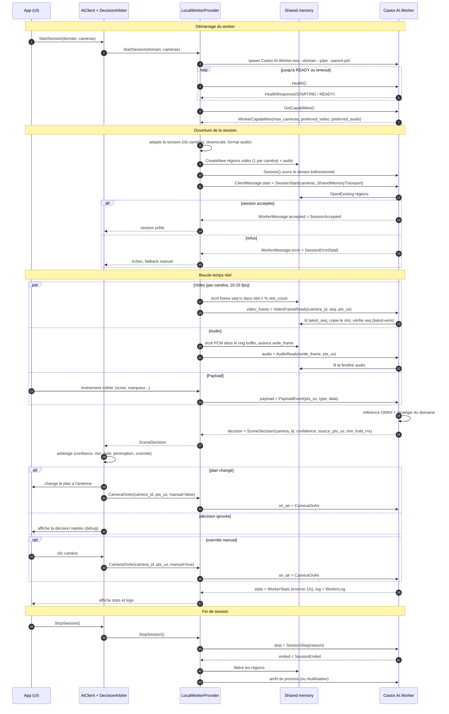

# Castor AI — Architecture du prototype

Objectif : valider la communication **AI <-> App** pour le changement de plan caméra en temps réel (stream).

- **App** : petite app Avalonia qui joue le rôle de Castor-Studio et affiche ce que la vraie app recevrait.
- **Worker** : process IA unitaire par domaine (podcast, football, basket…). Il reçoit payload et/ou vidéo et/ou audio, et renvoie des décisions de plan (`SceneDecision`).

Périmètre : l'architecture couvre le **local et le cloud**. Seul le **local** est implémenté dans le prototype.

Contrat : [`Castor.AI.Contracts/Protos/castor_ai.proto`](../Castor.AI.Contracts/Protos/castor_ai.proto).
SDK client utilisé par les apps : [`Castor.AI`](../Castor.AI/README.md) (`AiClient`).

---

## 1. Vue d'ensemble

```
Castor-Studio (Avalonia)
  AiClient (SDK Castor.AI) ── IAiProvider ──┐
  DecisionArbiter                     ├─ LocalWorkerProvider   [implémenté]
                                      │    spawn + supervise Castor.AI.Worker.exe
                                      │    gRPC sur named pipe : contrôle, payload, décisions
                                      │    médias : shared memory (1 région par caméra + 1 audio)
                                      │
                                      └─ CloudProvider   [design seulement]
                                           AiGateway.AllocateSession -> endpoint + ingest_uri
                                           gRPC TLS : contrôle, payload, décisions
                                           médias : flux encodé (SRT, H.264 basse résolution, Opus)
                                           ──> pod Worker : décodeur ──SHM──> Worker (même binaire)
```

### Composants

| Composant | Rôle |
|---|---|
| `AiClient` | Façade unique côté app (SDK `Castor.AI`). Session, horloge, arbitre, flux audio. L'app ne connaît que lui. |
| `IAiProvider` | Abstraction local/cloud : démarrer une session, pousser les médias, recevoir les décisions. |
| `LocalWorkerProvider` | Lance le worker, crée les régions SHM, écrit les frames, ouvre le stream gRPC, gère les crash et redémarrages. |
| `CloudProvider` | (design) Alloue une session via `AiGateway`, pousse un flux encodé, même stream gRPC. |
| `DecisionArbiter` | Côté app. Transforme les **suggestions** du worker en **plan à l'antenne** : seuil de confiance, `min_hold_ms`, rejet des décisions périmées, override manuel. |
| `Castor.AI.Worker` | Process .NET + ONNX Runtime. Un binaire, un domaine choisi au lancement. Identique en local et dans le cloud. |
| `IFrameSource` (worker) | Abstraction de lecture des médias : SHM en local ; dans le cloud, SHM alimentée par le décodeur du pod. |

### Choix techniques

- **Worker en C# .NET + ONNX Runtime.** Les modèles sont entraînés en Python puis exportés en `.onnx`. Aucune runtime Python n'est embarquée chez l'utilisateur. GPU via DirectML (Windows, tous vendeurs) ; CUDA dans le cloud.
- **Worker hors process.** Isolation des crash et de la mémoire GPU, et même forme en local et dans le cloud.
- **gRPC pour le contrôle, jamais pour les médias bruts.** Les frames passent par SHM ; gRPC ne porte que des notifications (« doorbell »).
- **Local : gRPC sur named pipe** (Kestrel `ListenNamedPipe`, .NET 8+). Fallback possible : `localhost` TCP.

---

## 2. Cycle de vie d'une session (local)

1. `LocalWorkerProvider` lance `Castor.AI.Worker.exe --domain <d> --pipe <name> --parent-pid <pid>`.
   - Le worker se termine si le process parent disparaît.
2. `LocalWorkerProvider` appelle `Health` jusqu'à `STATUS_READY` (timeout configurable), puis `GetCapabilities`.
3. L'app adapte la session aux capabilities :
   - nombre de caméras ≤ `max_cameras` ;
   - downscale vers `preferred_video` (ex. 640x360 BGRA, 10–15 fps) ;
   - audio vers `preferred_audio` (ex. 16 kHz, f32, 1 canal par micro).
4. L'app crée les régions SHM, puis ouvre `Session` et envoie `SessionStart`.
5. Le worker mappe les régions et répond `SessionAccepted` (ou `SessionError`).
6. Boucle :
   - app : écrit les frames et l'audio en SHM, envoie `VideoFrameReady` / `AudioReady` et les `PayloadEvent` ;
   - worker : envoie des `SceneDecision`, des `WorkerStats` (~1/s) et des `WorkerLog` ;
   - app : l'arbiter choisit le plan à l'antenne et renvoie `CameraOnAir` au worker.
7. Fin : `SessionStop`, puis `SessionEnded`. L'app libère les régions.

### Diagramme de séquence



### Pannes

- Stream gRPC coupé ou `Health` KO : l'app passe en **fallback** (garde le plan courant ou bascule en mode manuel), puis relance le worker avec backoff (1 s, 2 s, 5 s…).
- Aucune décision reçue depuis N secondes : `DecisionArbiter` signale « IA muette » dans l'UI, sans changer le plan.
- `SessionError.fatal = true` : session terminée, même traitement qu'une coupure.

---

## 3. Temps réel

- **Horloge maître = app.** `pts_us` en microsecondes depuis `SessionStart`, monotone. Toute décision référence `source_pts_us`.
- **Latest-wins.** Le worker traite toujours la frame la plus récente et ignore les autres (`frames_dropped`). Aucune file d'attente : le retard ne s'accumule jamais.
- **Péremption.** L'arbiter ignore une décision si `now - source_pts_us > max_decision_age_ms` (défaut 500 ms).
- **Budget de latence cible (local)** : < 300 ms entre la frame source et la décision reçue. Mesuré et affiché dans l'app de prototype.
- **Hystérésis.** C'est l'arbiter qui l'applique, pas le worker : `min_hold_ms`, seuil de confiance, et un écart minimal de score avant de changer de plan.

---

## 4. Format shared memory

Nommage :

- Windows : `Local\castor-<session_id>-video-<index>`, `Local\castor-<session_id>-audio`
- Linux (cloud) : `/dev/shm/castor-<session_id>-...`

`<index>` = rang de la caméra dans `SessionStart.cameras` : un id de caméra peut contenir n'importe quel
caractère. `VideoRegion.camera_id` porte la correspondance. Le SDK ne crée les régions vidéo que si le worker
déclare `INPUT_KIND_VIDEO` et un `preferred_video` BGRA8 ; il écrit alors toutes les caméras à cette taille.

Côté .NET : `MemoryMappedFile.CreateNew` (app) / `OpenExisting` (worker). Little-endian. Tous les offsets sont alignés sur 64 octets.

### Région vidéo (une par caméra)

```
RegionHeader (64 B)
  0   u32  magic        = 'CSVF' (0x46565343)
  4   u16  version      = 1
  6   u16  slot_count   (>= 3)
  8   u32  slot_size    (bytes, header de slot inclus, multiple de 64)
  12  u32  width
  16  u32  height
  20  u32  stride
  24  u32  pixel_format (enum PixelFormat)
  28  u32  reserved
  32  u64  latest_seq   (0 = aucune frame ; écrit en dernier, Volatile.Write)
  40..63   reserved

Slot[i] à offset 64 + i * slot_size
  SlotHeader (64 B)
    0   u64  seq          (écrit en dernier)
    8   i64  pts_us
    16  u32  data_size
    20..63   reserved
  Data (data_size octets)
```

**Écriture (app), frame `seq = n` :**

1. Choisir `slot = n % slot_count`.
2. Mettre `slot.seq = 0` (slot invalide pendant l'écriture).
3. Écrire `pts_us`, `data_size`, puis les pixels.
4. `Volatile.Write(slot.seq, n)`.
5. `Volatile.Write(header.latest_seq, n)`.
6. Envoyer `VideoFrameReady{seq = n}`.

**Lecture (worker) :**

1. `n = Volatile.Read(latest_seq)`. Si `n` = dernier traité : rien à faire.
2. `slot = n % slot_count`. Vérifier `slot.seq == n`, copier les données, puis relire `slot.seq`.
3. Si `slot.seq` a changé : frame déchirée, on la jette (`frames_torn`) et on recommence à l'étape 1.

Avec `slot_count >= 3` et un worker qui copie la frame avant l'inférence, les frames déchirées restent rares.

### Région audio

```
AudioHeader (64 B)
  0   u32  magic          = 'CSAU' (0x55415343)
  4   u16  version        = 1
  6   u16  channels
  8   u32  sample_rate
  12  u32  capacity_frames
  16  u64  write_frame    (total frames écrites ; Volatile.Write après les données)
  24  i64  base_pts_us    (pts de la frame 0)
  32..63   reserved
Data : ring buffer float32 interleaved, capacity_frames * channels
```

- `pts(frame k) = base_pts_us + k * 1e6 / sample_rate`.
- Le worker lit la fenêtre `[write_frame - window, write_frame)`. Si son retard dépasse `capacity_frames`, il saute en avant.
- Mapping micro / caméra : `CameraDescriptor.audio_channel`.
- Capacité conseillée : 2 s.

---

## 5. Cloud (design, non implémenté)

1. `CloudProvider` appelle `AiGateway.AllocateSession(domain, camera_count, inputs)` et reçoit `worker_endpoint`, `ingest_uri` et `access_token`.
2. L'app pousse les caméras downscalées et l'audio en flux encodé vers `ingest_uri` (SRT, H.264 + Opus, un stream par caméra).
3. L'app ouvre `AiWorker.Session` sur `worker_endpoint` (gRPC TLS + token), avec `EncodedStreamTransport` dans `SessionStart`.
4. Dans le pod :
   - un décodeur (FFmpeg) écrit dans la SHM du pod, au même format qu'en local ;
   - le worker est le même binaire et lit cette SHM.
5. La session est **affine** à un pod : le stream gRPC et l'ingest pointent vers le même pod pendant toute la session. Le LB (ex. Envoy) doit gérer HTTP/2 et les streams longs.
6. Aucun `VideoFrameReady` n'est envoyé : le décodeur du pod notifie le worker en interne.

Points ouverts pour le cloud :

- latence réseau et encodage (probablement 150–400 ms de plus) ;
- coût GPU par session ;
- authentification ;
- choix local/cloud par domaine dans `AiClient` (choix du provider).

---

## 6. Structure du repo

Repo `Castor-AI-Worker` (GitHub `Castor-Studio/Castor-AI-Worker`), séparé de Castor Studio. Studio n'en consomme
que le SDK (`Castor.AI` + `Castor.AI.Contracts`) et le binaire du worker.

```
Castor-AI-Worker/
  docs/architecture.md
  scripts/                 publish-models.ps1, export-football-model.ps1, generate-sample-dialogue.ps1,
                           generate_football_fixtures.py, export_football_model.py
  packs/<domaine>/models/  modèles téléchargés (ignoré par git)
  samples/                 dialogue et clips football de test générés (ignoré par git)
  Castor.AI/               SDK client (AiClient, LocalWorkerProvider, arbitre, flux audio) : référencé par Castor Studio
  Castor.AI.Contracts/     contrat : proto + code gRPC généré + format SHM (partagé SDK / workers)
  Castor.AI.Worker/        console : serveur gRPC (named pipe), lecture SHM, stratégies par domaine
  Castor.AI.Dashboard/        console de debug Avalonia, n'utilise l'IA qu'à travers Castor.AI
  Castor.AI.Tests/         xUnit : AiClient, arbitre, flux audio, flux vidéo
  Castor.AI.Worker.Tests/  xUnit : director, rôles, VAD, rings audio et vidéo, football (parité Python)
  Castor.AI.Worker.sln
```

### UI de l'app de prototype

L'app est une console de debug pour l'équipe IA, **générique** : rien n'y est propre au podcast.

- **Profils de session** (`profiles/*.json`) : domaine du worker, caméras (id, label, rôle, micro, fichier audio),
  `params`, règles de l'arbitre, et boutons par caméra (`camera_actions` : payload envoyé, en bouton ou en
  bascule on/off). Un nouveau modèle IA = un nouveau profil, sans toucher au code de l'app.
- **Capabilities** : le worker déclare ses métriques (`MetricDescriptor`, par session ou par caméra, avec
  unité et plage) et ses flags par caméra (`FlagDescriptor`). L'app en déduit les jauges et badges des
  cartes caméra et un graphe par métrique ; `WorkerStats.metrics` / `WorkerStats.cameras` portent les valeurs.
- **Vues temps réel** : timeline des plans à l'antenne (60 s, IA / manuel, suggestions acceptées ou rejetées),
  graphe de latence (âge de la décision à réception, temps de traitement worker, inférence moyenne) avec
  p50 / p95 / max sur 30 s, liste des `SceneDecision` (raison du worker, verdict de l'arbitre, scores,
  transition), envoi manuel de n'importe quel payload déclaré, onglet capabilities, logs.
- `--autostart [nom du profil]` démarre une session au lancement.

### Étapes

1. ~~Contracts, plus un worker « Podcast » qui ne lit que le payload, plus l'app qui affiche les décisions.~~ Fait.
2. ~~Vidéo par SHM : sources de test (fichiers via FFmpeg, ou image fixe), downscale, doorbell.~~ Fait, voir section 8.
3. ~~Audio par SHM : stratégie Podcast « qui parle » (Silero VAD par micro, puis caméra liée).~~ Fait, voir section 7.
4. Inférence ONNX : ~~CPU + mesure de latence~~ (fait, section 8) ; reste DirectML et le stress test sur le nombre de caméras.
5. Plus tard : `CloudProvider` et `AiGateway`.

---

## 7. Worker Podcast

Port en C# du module Python `castostudio_ai_podcast` (Castor-AI, branche `dev`, « director engine v2 »).
Les tests pytest correspondants sont portés en xUnit (`Castor.AI.Worker.Tests/Podcast`).

### Pipeline

```
App : fichier audio par micro (ffmpeg) ─► AiClient.WriteAudio ─► AudioFeed du SDK (16 kHz, blocs de 512 frames, 32 ms)
    ─► ring audio SHM (1 canal par micro) + doorbell AudioReady
Worker : ring ─► 1 Silero VAD (ONNX) par canal ─► is_speaking + niveau dB
       + payloads app (camera.metadata / speaker.*) ─► PodcastDirector ─► SceneDecision
```

- **VAD** : Silero VAD v6.2.1 (même version que Castor-AI), ONNX Runtime CPU, un état récurrent par micro.
  Port de `OnnxWrapper` + `VADIterator`. Modèle téléchargé par le worker au premier lancement (section 9).
- **Rôles** : `CameraDescriptor.role` explicite (`host`, `guest`, `guest2`…, `wide`, `<rôle>_zoom`) ;
  sinon heuristique sur les labels, identique au Python. Le micro d'un rôle = `CameraDescriptor.audio_channel`.
- **Director** : même algorithme et mêmes paramètres (`SessionStart.params`, mêmes clés que `module_config`) :
  métadonnées OU VAD, veto « chaise vide » (`person_detected` / `face_detected`), cross-gating, filtre
  backchannel, silence / débat / orateur unique, zoom monologue, ping-pong, `min_hold_time`.

### Écarts volontaires avec le Python

| Sujet | Python | Ici | Pourquoi |
|---|---|---|---|
| Plan courant | supposé appliqué dès la décision | vient de `CameraOnAir` (l'app) | l'arbitre ou l'opérateur peuvent refuser ou forcer un plan |
| Décision refusée | jamais reproposée | reproposée après 1 s | sinon le director reste bloqué sur un plan que l'app n'a pas pris |
| `level_smoothing_ms` | n'existe pas | 0 par défaut (= Python), 300 dans l'app | voir ci-dessous |

**Faux débats.** Le cross-gating compare le niveau du dernier chunk (32 ms). Pendant une pause entre deux
phrases, tous les micros tombent au même plancher alors que la VAD reste « speaking » (hangover de
`min_silence_duration_ms`) sur le micro de l'orateur *et* sur ceux qui captent sa diaphonie : le gating garde
tout le monde, et le director coupe en plan large en plein monologue. Mesuré sur le dialogue de test :
3 faux « Debate → wide » en 52 s sans lissage, 0 avec `level_smoothing_ms=300` (lissage exponentiel de
l'énergie, qui conserve l'écart de niveau entre micros pendant la pause). Le défaut existe aussi côté Python.

### Tester

```
powershell -ExecutionPolicy Bypass -File scripts/generate-sample-dialogue.ps1
dotnet test
dotnet run --project Castor.AI.Dashboard
```

`generate-sample-dialogue.ps1` crée `samples/host.wav`, `guest.wav`, `guest2.wav` : un dialogue TTS de 52 s
(monologue, tours de parole, chevauchement guest/guest2, silence de 4,5 s) avec diaphonie à -20 dB.
L'app les assigne automatiquement aux caméras de même rôle ; n'importe quel fichier audio ou vidéo peut
les remplacer (bouton « Audio file… », ffmpeg requis dans le `PATH` ou `CASTOR_FFMPEG`).

---

## 8. Worker Football

Port en C# du module Python `castostudio_ai_football` (Castor-AI, branche `dev`) : `BallDetector`,
`FootballAnalyzer.analyze_once` et `FootballModule.analyze_sources`.

### Pipeline

```
Studio : frame BGRA de chaque scène (n'importe quelle taille) ─► AiClient.WriteVideo
    ─► VideoFeed du SDK : mise à l'échelle 640x360, cadence 15 fps max par caméra
    ─► région vidéo SHM (1 par caméra, 3 slots, latest-wins) + doorbell VideoFrameReady
Worker : dernière frame de chaque caméra ─► resize 416x416 (même interpolation que cv2.INTER_LINEAR)
       ─► YOLO (ONNX Runtime CPU) ─► « ballon trouvé » par caméra ─► FootballFocus ─► SceneDecision
```

- **Modèle** : `checkpoint_5.pt` de Castor-AI (YOLOv9c COCO, classe 32 « sports ball »), exporté en
  `packs/football/models/checkpoint_5_416.onnx` par `scripts/export-football-model.ps1` (ultralytics de
  l'environnement Castor-AI, entrée statique 1x3x416x416, opset 17), puis publié dans la release `models-v1`
  par `scripts/publish-models.ps1` (section 9). Seul l'export demande un checkout de Castor-AI.
- **Détection** : mêmes seuils que `constants.py` (`PREDICTION_CONFIDENCE` 0,25, `BALL_CONFIDENCE` 0,60).
  Ultralytics garde une boîte si sa meilleure classe dépasse 0,25 et l'étiquette avec cette classe ; la NMS
  n'enlève jamais la meilleure boîte d'une classe. « Ballon trouvé » se calcule donc sans NMS : une ancre dont
  la meilleure classe est le ballon, avec un score ≥ 0,60.
- **Règle** (identique au Python pour 2 caméras, appliquée à N) : ballon sur une seule caméra = focus sur
  elle ; ballon sur plusieurs caméras ou sur aucune = focus inchangé ; rien tant que chaque caméra n'a pas été
  analysée une fois.
- **Paramètres** (`SessionStart.params`) : `default_confidence` (1,0), `frameskip` (0), plus, absents du
  Python : `ball_confidence`, `prediction_confidence`, `swap_red_blue`, `min_hold_ms` (0 = règle de l'arbitre).
- **Capabilities** : vidéo requise, 640x360 BGRA8 à 15 fps, 4 caméras max ; métriques par caméra
  `ball_conf`, `detect_ms` ; flags `BALL`, `FOCUS`.

### Parité avec le Python

`Castor.AI.Worker.Tests/Football` compare le port au vrai pipeline ultralytics sur des frames générées par
`scripts/generate_football_fixtures.py` (terrain avec ballon, terrain vide, photo `zidane.jpg` d'ultralytics) :
mêmes classes gardées, scores à ±0,005 près (float32) et ±0,01 près face au Python CUDA demi-précision.
Le redimensionnement reproduit la passe SIMD de `cv2.resize` (poids 11 bits) : 99,95 % des pixels identiques.

### Écarts volontaires avec le Python

| Sujet | Python | Ici | Pourquoi |
|---|---|---|---|
| Caméras | 2 premières sources | N caméras (max 4), même règle | Studio peut proposer plus de 2 scènes |
| Plan courant | dernière décision envoyée | `CameraOnAir` (l'app) | comme le podcast : arbitre et opérateur peuvent refuser ou forcer |
| Décision refusée | jamais reproposée | reproposée après 1 s | sinon le focus reste bloqué |
| Flux vidéo | OpenCV lit l'URL de chaque scène | frames brutes en SHM (640x360) | pas d'encodage / décodage en local |
| Précision | CUDA, demi-précision | ONNX Runtime CPU, float32 | pas de runtime CUDA chez l'utilisateur ; DirectML à faire |

**Ordre des canaux.** `detector.py` convertit la frame en RGB, puis ultralytics la retourne à nouveau (il
attend du BGR pour un tableau numpy) : le modèle reçoit donc du **BGR**, alors qu'il a été entraîné en RGB.
Le port reproduit ce comportement par défaut. Sur les fixtures, l'ordre RGB (`swap_red_blue=true`) donne
0,47 au lieu de 0,67 sur le ballon, mais 0,74 au lieu de 0,55 sur la cravate de `zidane.jpg` : à trancher par
l'équipe IA sur de vraies images de match.

### Performances mesurées (Debug, CPU du portable de dev, 2 caméras)

- démarrage du worker jusqu'à `SessionAccepted` : 0,7 s (chargement du modèle et première inférence compris) ;
- détection : ~95 ms par frame, soit ~5 frames analysées par seconde et par caméra ;
- latence frame source → suggestion reçue : 160–205 ms (cible < 300 ms).

### Tester

```
powershell -ExecutionPolicy Bypass -File scripts/export-football-model.ps1
cd ../Castor-AI
uv run --no-sync python -I ../Castor-AI-Worker/scripts/generate_football_fixtures.py ../Castor-AI-Worker/Castor.AI.Worker.Tests/Football/Fixtures ../Castor-AI-Worker/samples
cd ../Castor-AI-Worker
dotnet test
dotnet run --project Castor.AI.Dashboard -- --autostart "Football - 2 cameras"
```

Le profil `profiles/football.json` lit `samples/football_left.mp4` et `football_right.mp4` (ballon à gauche
puis à droite, 3 s chacun, en boucle ; ffmpeg requis). Sans ffmpeg, choisir `samples/football_ball.png` /
`football_empty.png` avec le bouton « File… » de la ligne vidéo de chaque caméra.

---

## 9. Modèles : installation et téléchargement

Studio et le worker vivent dans deux repos. Studio ne livre que le worker ; le worker se charge de ses modèles.

Au démarrage, pour chaque modèle de son domaine (`Castor.AI.Worker/Models/models.json`, lu par `ModelCatalog`),
le worker prend le premier disponible :

1. un pack installé : `CASTOR_PACKS_DIR`, `packs/` à côté du worker, ou le `packs/` le plus proche au-dessus (dev) ;
2. le cache : `CASTOR_MODELS_DIR`, sinon `%LOCALAPPDATA%\Castor\models\<domaine>\<fichier>` ;
3. sinon il le télécharge dans le cache : `CASTOR_MODELS_URL` + `/<fichier>` si la variable existe (miroir,
   autre release), sinon l'URL du catalogue.

Chaque téléchargement est vérifié par SHA-256 (épinglé dans `models.json`) dans un fichier temporaire, puis
renommé : un fichier partiel ou corrompu n'est jamais chargé. Pendant ce temps `Health` reste `STARTING` et
`detail` porte la progression ; le SDK la remonte dans `StateChanged` et repousse son timeout à chaque progrès.
Un échec (HTTP, checksum, pas de source) arrête le worker avec le code 3 et un message explicite.

Les tests passent par le même mécanisme (`TestModels`) : aucun script à lancer avant `dotnet test`.

### Hébergement : releases de ce repo

Les modèles sont des assets de la release `models-v1` de `Castor-Studio/Castor-AI-Worker`
(`https://github.com/Castor-Studio/Castor-AI-Worker/releases/download/models-v1/<fichier>`). Le repo doit être
**public** : le worker installé chez l'utilisateur télécharge sans jeton. Les noms de fichiers sont uniques
entre domaines, tous les modèles d'une version étant côte à côte dans une même release.

| Modèle | Fichier | Origine |
|---|---|---|
| Silero VAD v6.2.1 (MIT) | `silero_vad.onnx` (2 Mo) | copie du fichier publié par le projet Silero |
| Ballon (YOLOv9c COCO) | `checkpoint_5_416.onnx` (100 Mo) | `scripts/export-football-model.ps1` |

**Configuration** : tout est dans `Castor.AI.Worker/Models/models.json`, embarqué dans le worker :
`repository` et `release_tag` désignent la release, chaque entrée donne `domain`, `file`, `sha256` et `url`,
son lien de téléchargement. Seuls les liens de cette release sont acceptés
(`https://github.com/<repository>/releases/download/<release_tag>/<file>`) : le worker refuse un
`models.json` qui pointe ailleurs, aucune source tierce ne peut s'y glisser. Changer un lien = éditer ce
fichier, pas le code.
`CASTOR_MODELS_MANIFEST=<chemin d'un models.json>` le remplace à l'exécution, sans rebuild.

**Publier** : `scripts/publish-models.ps1` (`-DryRun` pour voir sans publier) lit `models.json`, vérifie
chaque fichier local contre son hash, puis crée la release ou y ajoute les fichiers manquants (`gh`).
Un asset publié ne change jamais : un nouveau modèle = nouveau nom de fichier, nouveau SHA-256 dans
`models.json`, et nouvelle release (`models-v2`) si besoin. L'export ONNX n'est pas reproductible octet par
octet : publier exactement le fichier dont le SHA-256 est épinglé, ou ré-épingler.
